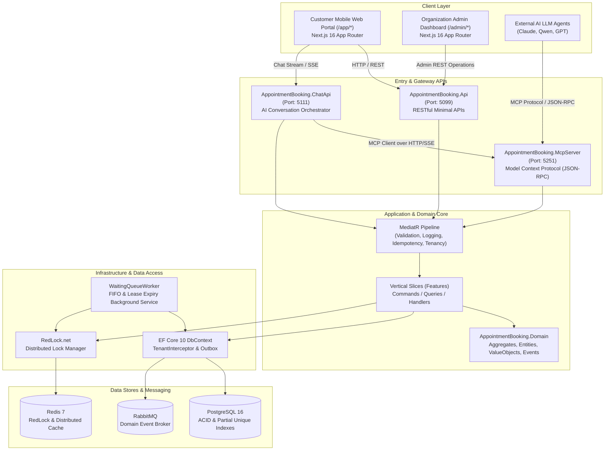
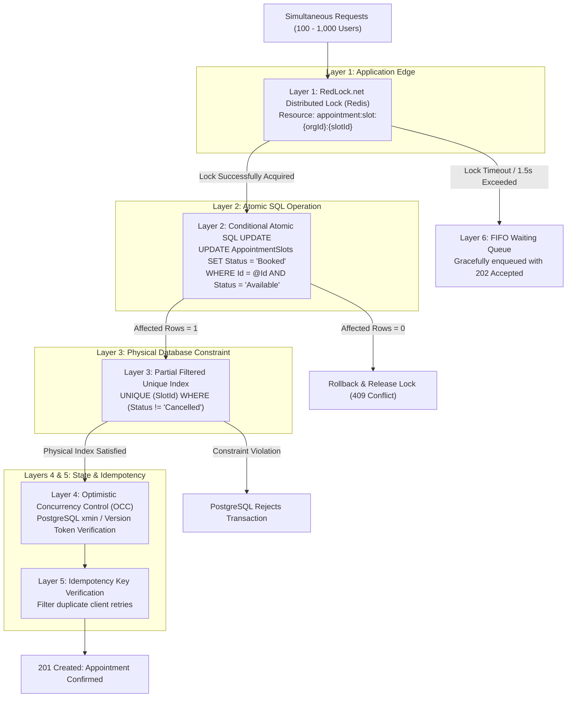
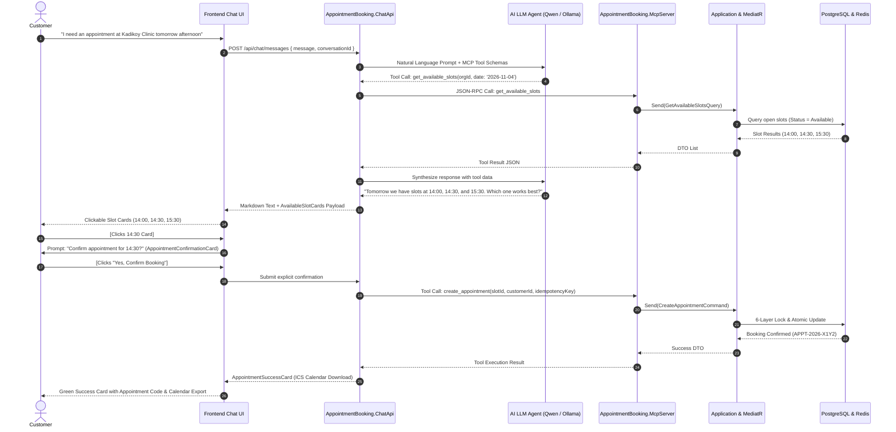
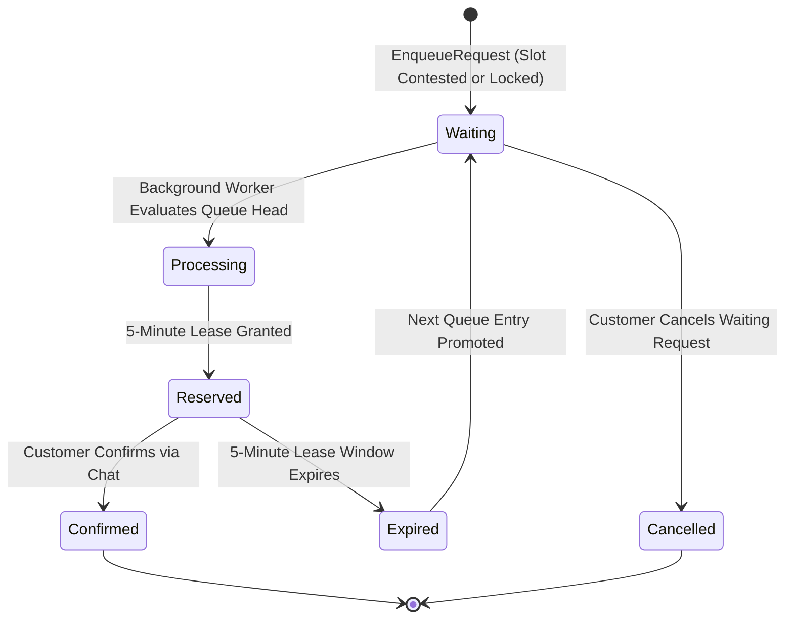
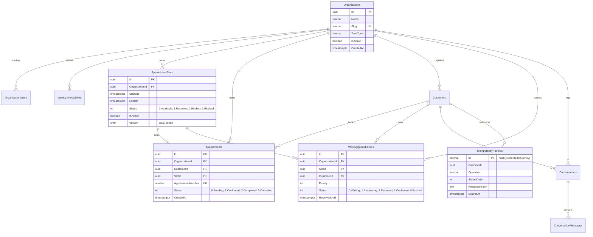

# 🏥 AI-Powered Multi-Tenant Appointment Booking Platform

> **High-Concurrency**, **Zero Double-Booking Guarantee (6-Layer Defense)**, and **Model Context Protocol (MCP)** Native AI Agent Integration for enterprise appointment and scheduling operations.

---

## 📑 Table of Contents
1. [Executive Summary & Core Highlights](#-executive-summary--core-highlights)
2. [Technology Stack](#-technology-stack)
3. [System Architecture](#-system-architecture)
4. [Codebase & Directory Structure](#-codebase--directory-structure)
5. [Architectural Patterns & Design Principles](#-architectural-patterns--design-principles)
6. [6-Layer Defense-in-Depth Concurrency Model (Zero Double-Booking)](#-6-layer-defense-in-depth-concurrency-model-zero-double-booking)
7. [Model Context Protocol (MCP) & AI Agent Integration](#-model-context-protocol-mcp--ai-agent-integration)
8. [Sequence & Flow Diagrams](#-sequence--flow-diagrams)
9. [Database Schema & ER Diagram](#-database-schema--er-diagram)
10. [Frontend Architecture & Conversational UI/UX](#-frontend-architecture--conversational-uiux)
11. [Waiting Queue Architecture & Lease Processing](#-waiting-queue-architecture--lease-processing)
12. [Service & Port Mapping](#-service--port-mapping)
13. [Testing Strategy & Load Verification](#-testing-strategy--load-verification)
14. [Getting Started & Local Development Guide](#-getting-started--local-development-guide)

---

## 🎯 Executive Summary & Core Highlights

The **AI-Powered Appointment Booking Platform** is an enterprise-grade, distributed, multi-tenant scheduling platform built for medical clinics, wellness centers, advisory firms, and service-based organizations.

### 🌟 Key Capabilities:
* **🤖 Conversational AI Booking Experience:** Customers book, reschedule, and cancel appointments using natural language chat instead of dense forms and confusing date pickers. The chat dynamically renders interactive action cards for slot selection and explicit confirmations.
* **🛡️ Zero Double-Booking Guarantee:** A **6-Layer Defense-in-Depth Concurrency Architecture** makes overlapping reservations mathematically and physically impossible, even under flash-crowd bursts of 500–1,000 simultaneous requests per slot.
* **🔌 Native Model Context Protocol (MCP) Server:** A dedicated `AppointmentBooking.McpServer` implementing standard JSON-RPC 2.0 / SSE transports allows LLMs (Claude, GPT, Qwen) to execute actions strictly through application business rules and concurrency locks without direct database access.
* **🏢 Strict Logical Multi-Tenancy:** Row-level tenant isolation enforced via EF Core Global Query Filters, `TenantInterceptor`, and composite database indices ensures zero data leaks across organizations.
* **⏳ Intelligent FIFO Waiting Queue:** High-demand or locked slots automatically route contenders to an asynchronous waiting queue with lease expirations and automated promotion upon cancellations.
* **⚡ Modern Next.js 16 Web Application:** Built with React 19, App Router, and Tailwind CSS v4, providing both a high-density administrative portal and a mobile-first conversational customer interface.

---

## 🛠️ Technology Stack

| Layer | Technologies |
| :--- | :--- |
| **Backend Core** | .NET 10 (C# 14), ASP.NET Core Minimal APIs |
| **Architecture Patterns** | Clean Architecture, Vertical Slice Architecture, CQRS, Domain-Driven Design (DDD) |
| **Mediation & Validation** | MediatR, FluentValidation, Pipeline Behaviors |
| **Data Persistence & ORM** | Entity Framework Core 10, Npgsql (PostgreSQL 16) |
| **Distributed Locking & Caching**| Redis 7, RedLock.net (Distributed Lock Manager), StackExchange.Redis |
| **Messaging & Events** | RabbitMQ 3.13, Transactional Outbox & Inbox Pattern |
| **AI Orchestration & MCP** | Model Context Protocol (JSON-RPC 2.0 / SSE), Qwen / Ollama / OpenAI Integration |
| **Frontend Framework** | Next.js 16 (App Router), React 19, TypeScript (Strict), Tailwind CSS v4 |
| **UI Components & State** | Radix UI, TanStack React Query v5, Lucide React, Recharts, Sonner |
| **Observability & Diagnostics** | OpenTelemetry, Serilog, Structured JSON Logging |
| **Automated Testing** | xUnit, FluentAssertions, WebApplicationFactory, NetArchTest.eNhancedEdition |
| **Containerization** | Docker, Docker Compose, Multi-stage Dockerfiles |

---

## 🏗️ System Architecture

The solution decouples presentation, mediation, domain rules, and external capabilities into modular, independently scalable services:



---

## 📂 Codebase & Directory Structure

```text
appointment-ai-assistant/
├── AppointmentBooking.sln               # Solution configuration file
├── docker-compose.yml                   # PostgreSQL, Redis, RabbitMQ & service containers
├── Directory.Build.props                # Global C# compiler rules & nullable checks
│
├── src/
│   ├── AppointmentBooking.Domain/       # Pure Enterprise Business Rules (Zero Dependencies)
│   │   ├── Common/                      # BaseEntity, AggregateRoot, ValueObject, IDomainEvent
│   │   ├── Entities/                    # Organization, Customer, AppointmentSlot, Appointment, WaitingQueueEntry
│   │   ├── ValueObjects/                # TimeRange, TimeZoneCode, PhoneNumber, Money
│   │   ├── Enums/                       # SlotStatus, AppointmentStatus, QueueStatus
│   │   ├── Exceptions/                  # Strongly-typed domain exceptions
│   │   └── Events/                      # AppointmentCreatedDomainEvent, SlotReleasedDomainEvent
│   │
│   ├── AppointmentBooking.Application/  # Vertical Slice Features (CQRS with MediatR)
│   │   ├── Common/                      # ICommand, IQuery, Pipeline Behaviors (Validation, Logging)
│   │   ├── Interfaces/                  # IDistributedLockManager, IApplicationDbContext, ITenantContext
│   │   └── Features/                    # Each business feature encapsulated in a vertical slice:
│   │       ├── Organizations/           # CreateOrg, GetOrg, GetBySlug, ListOrgs
│   │       ├── Availabilities/          # SetWeeklySchedule, GenerateSlots, ToggleSlotStatus
│   │       ├── Appointments/            # CreateAppointment, CancelAppointment, GetCustomerAppointments
│   │       ├── Customers/               # RegisterCustomer, GetCustomerDetails
│   │       └── WaitingQueue/            # EnqueueRequest, GetQueueStatus, CancelQueueRequest
│   │
│   ├── AppointmentBooking.Infrastructure/ # Persistence, Distributed Locks & External Adapters
│   │   ├── Persistence/                 # ApplicationDbContext, Entity Configurations, Migrations
│   │   ├── Interceptors/                # TenantInterceptor (Multi-tenant global query filter)
│   │   ├── DistributedLock/             # RedLock.net integration with Fail-Closed safeguards
│   │   ├── BackgroundServices/          # WaitingQueueWorker (Lease expiration & queue promotion)
│   │   └── Outbox/                      # OutboxMessageProcessor & event publisher
│   │
│   ├── AppointmentBooking.Api/          # RESTful Minimal APIs (Admin & Public Clients)
│   │   ├── Endpoints/                   # Modular IEndpoint implementations
│   │   ├── Middlewares/                 # TenantResolutionMiddleware, GlobalExceptionHandling
│   │   └── Extensions/                  # Service registrations & OpenAPI/Swagger specs
│   │
│   ├── AppointmentBooking.McpServer/    # Model Context Protocol (MCP) Host Service
│   │   ├── Tools/                       # 9 official MCP Tool definitions & JSON schemas
│   │   ├── Handlers/                    # JSON-RPC 2.0 mapping to MediatR commands
│   │   └── Transports/                  # HTTP POST (`/mcp`) & SSE (`/mcp/sse`) handlers
│   │
│   └── AppointmentBooking.ChatApi/      # Conversational Agent Orchestrator
│       ├── Services/                    # LLM Client, Agent Session State Machine, Tool Caller
│       ├── Endpoints/                   # `/api/chat/messages`, `/api/chat/conversations`
│       └── Models/                      # AgentResponseDto, Discriminated Card Payloads
│
├── frontend/                            # Next.js 16 + React 19 + Tailwind v4 Web Client
│   ├── src/
│   │   ├── app/
│   │   │   ├── (public)/                # SaaS Landing Page & Organization Discovery
│   │   │   ├── (auth)/                  # 1-Click Login & Onboarding (Customer & Admin)
│   │   │   ├── (admin)/admin/           # Dashboard, Appointments, Calendar, Slot Generator, Queue
│   │   │   └── (customer)/app/          # Mobile-First AI Chat Portal, My Appointments, Profile
│   │   ├── components/
│   │   │   ├── ui/                      # Design system primitives (Button, Card, Input, Dialog...)
│   │   │   └── chat/                    # Action cards (AvailableSlots, Confirmation, Success...)
│   │   ├── lib/api/client.ts            # Type-safe API client with automatic token & tenant headers
│   │   └── providers/                   # TanStack Query, NextThemes, Sonner Toast Provider
│   ├── Dockerfile                       # Multi-stage container deployment
│   └── package.json
│
├── tests/
│   ├── AppointmentBooking.UnitTests/         # DDD invariants, slot overlap, and ValueObject unit tests
│   ├── AppointmentBooking.ArchitectureTests/ # Clean Architecture boundary enforcement (NetArchTest)
│   ├── AppointmentBooking.IntegrationTests/  # Real DB & Redis end-to-end API lifecycle tests
│   └── AppointmentBooking.ConcurrencyTests/  # 500 concurrent request stress tests (Zero Double-Booking)
│
└── docs/                                # Architecture Decision Records (ADRs) & technical specs
```

---

## 💎 Architectural Patterns & Design Principles

### 1. Clean Architecture Combined with Vertical Slice Architecture
Instead of scattering business logic across bloated controller, service, and repository layers, each feature is organized as a self-contained **Vertical Slice**:
* A feature folder (`Features/Appointments/CreateAppointment`) encapsulates its own `Command`, `Handler`, `Validator`, `Response DTO`, and `Endpoint mapping`.
* **Layer Dependency Rule:** `Domain` has zero third-party dependencies. `Application` references only `Domain`. Adapters (`Infrastructure`, `Api`, `McpServer`) implement abstractions defined in `Application`.

### 2. Domain-Driven Design (DDD)
* **Aggregate Roots:** `AppointmentSlot` and `Appointment` maintain strict consistency boundaries and enforce all state transition invariants internally.
* **Value Objects:** `TimeRange`, `PhoneNumber`, and `Money` are immutable; invalid date ranges or misformatted phone numbers are caught at instantiation.
* **Domain Events:** State mutations trigger events (`AppointmentCreatedDomainEvent`, `SlotReleasedDomainEvent`) committed within the same unit of work via the Transactional Outbox pattern.

### 3. MediatR Pipeline Behaviors
All incoming requests flow through an automated chain of cross-cutting behaviors:
1. `TenantResolutionBehavior`: Verifies tenant membership and sets active execution context.
2. `ValidationBehavior`: Executes FluentValidation rules, failing fast with `400 Bad Request` prior to reaching handlers.
3. `IdempotencyBehavior`: Intercepts client `IdempotencyKey` headers to prevent duplicate executions from network retries.
4. `LoggingAndPerformanceBehavior`: Automatically profiles execution times and logs warnings for requests exceeding 500ms.

### 4. Transactional Outbox Pattern
Domain events are written to an `OutboxMessages` database table within the same atomic database transaction as the business entity changes. A background processor reliably dispatches messages to RabbitMQ, eliminating Dual-Write inconsistency risks.

---

## 🛡️ 6-Layer Defense-in-Depth Concurrency Model (Zero Double-Booking)

The primary invariant of the platform: **"Even if 1,000 customers request the exact same appointment slot in the same millisecond, zero double-booking is guaranteed."**

A **6-Layer Defense-in-Depth Model** provides end-to-end protection against concurrency bugs, distributed network partitions, and edge-case race conditions:



### Detailed Breakdown of the 6 Layers:
1. **Layer 1: RedLock.net (Redis Distributed Lock):** Serializes competing threads across distributed nodes. Protects database connection pools from exhaustion during flash traffic.
2. **Layer 2: Conditional Atomic SQL UPDATE:** Even during Redis partition or lease expiration, `UPDATE ... WHERE Status = 'Available'` atomically succeeds for exactly one connection; all other contenders receive 0 affected rows and rollback immediately.
3. **Layer 3: Database Partial Filtered Unique Index:** A physical database index `CREATE UNIQUE INDEX "IX_Appointments_SlotId_Active" ON "Appointments" ("SlotId") WHERE "Status" <> 3;` guarantees that the database engine itself rejects duplicate active bookings on disk.
4. **Layer 4: Optimistic Concurrency Control (xmin token):** Detects concurrent administrative schedule modifications or slot deactivations.
5. **Layer 5: Idempotency Key Storage:** Maps `(CustomerId, Operation, IdempotencyKey)`. Retried network requests return the existing appointment without side effects.
6. **Layer 6: FIFO Waiting Queue Fallback:** Requests that miss the distributed lock are not rejected with generic errors; they are automatically enqueued in order of arrival.

---

## 🤖 Model Context Protocol (MCP) & AI Agent Integration

The platform provides a first-class **Model Context Protocol (MCP)** server enabling external AI models to interact with the scheduling system securely.

### Tool Catalog (9 Official MCP Tools):
1. `get_organization_info`: Retrieves organization profile, operating hours, address, and IANA timezone.
2. `get_available_dates`: Lists upcoming calendar dates containing open appointment slots.
3. `get_available_slots`: Returns available slots formatted in the organization's local timezone.
4. `create_appointment`: Reserves a slot under RedLock protection and database uniqueness constraints.
5. `get_appointment`: Fetches appointment details and current status by ID.
6. `get_customer_appointments`: Lists active and historical bookings for a given customer.
7. `cancel_appointment`: Cancels a booking, marks the slot as available, and promotes waiting queue candidates.
8. `get_queue_status`: Checks position in line, estimated wait time, and reservation lease countdowns.
9. `cancel_queue_request`: Removes a user's entry from the waiting queue.

> **Security Rule:** AI agents never have direct database access. Every tool call invokes an Application MediatR command and passes through full validation, tenant scoping, and distributed locking pipelines.

---

## 📊 Sequence & Flow Diagrams

### 1. Conversational AI Appointment Booking Sequence



---

### 2. Waiting Queue State Machine



---

## 🗄️ Database Schema & ER Diagram



---

## 💻 Frontend Architecture & Conversational UI/UX

Built using **Next.js 16 (App Router)** and **Tailwind CSS v4**, the frontend provides two purpose-built workspaces sharing a unified design token system:

### 1. Partitioned Routing Structure:
* **Admin Workspace (`/admin/*`):**
  * `dashboard`: Real-time KPI summaries, booking trends, and Recharts interactive graphs.
  * `calendar`: Day and week calendar grids with 1-click slot locking and capacity toggling.
  * `availability`: Weekly working hours template and batch slot generation engine.
  * `appointments`: Searchable, filterable administrative table with cancellation dialogs.
  * `waiting-queue`: Real-time candidate positions, priority scores, and lease countdowns.
* **Customer Portal (`/app/*`):**
  * `chat` & `chat/[slug]`: Fullscreen, mobile-optimized AI booking assistant with action cards.
  * `my-appointments`: Active, historical, and cancelled bookings with .ics calendar downloads.
  * `organizations`: Searchable directory of participating clinics and service providers.

### 2. Discriminated Action Cards:
The chat engine never dumps unformatted text or raw JSON; responses render structured UI cards based on the backend `cardType`:
* `AvailableSlotCards`: Interactive 1-click time slot selection buttons.
* `AppointmentConfirmationCard`: Explicit "Yes, Confirm Booking" / "Change Slot" prompt.
* `AppointmentSuccessCard`: Confirmed status pill, appointment reference code, and ICS download.
* `AppointmentCancellationCard`: Explicit cancellation reason review and confirmation.
* `WaitingQueueCard`: Real-time queue position and active 5-minute countdown timer.
* `TypingIndicator`: Animated micro-status indicating active MCP tool executions.

---

## 🌐 Service & Port Mapping

Default network ports across services in local development and container environments:

| Service Name | Port | Protocol / Transport | Purpose |
| :--- | :--- | :--- | :--- |
| **Next.js Frontend** | `http://localhost:3000` | HTTP / Web UI | Admin Dashboard & Customer Chat Experience |
| **Appointment Core API** | `http://localhost:5099` | HTTP / REST | Organization, Availability, Slot & Appointment APIs |
| **AI Chat API** | `http://localhost:5111` | HTTP / REST | Conversational LLM Orchestrator |
| **MCP Server** | `http://localhost:5251` | JSON-RPC / SSE | Model Context Protocol Tool Server |
| **PostgreSQL 16** | `localhost:5432` | TCP / SQL | Primary Database (`appointment_db`) |
| **Redis 7** | `localhost:6379` | TCP / Cache | RedLock Distributed Locks & Cache |
| **RabbitMQ Management** | `http://localhost:15672` | HTTP / AMQP | Message Broker Admin Panel (User: `appointment_guest`) |

---

## 🧪 Testing Strategy & Load Verification

The test suite includes **41 automated tests** covering architectural boundaries, unit invariants, end-to-end integration flows, and concurrency stress scenarios:

```text
Test Run Summary: Total: 41 | Passed: 41 | Failed: 0 | Skipped: 0
```

1. **`AppointmentBooking.UnitTests` (17 Tests - Passed):**
   * Aggregate root consistency boundaries, time slot overlap validation, Value Object invariants, and state machine transitions.
2. **`AppointmentBooking.ArchitectureTests` (5 Tests - Passed):**
   * NetArchTest rules enforcing Clean Architecture layers (e.g., Domain having no external dependencies).
3. **`AppointmentBooking.IntegrationTests` (13 Tests - Passed):**
   * Real PostgreSQL and Redis container tests verifying full appointment lifecycles, tenant isolation filters, and MCP Server tool calls.
4. **`AppointmentBooking.ConcurrencyTests` (6 Tests - Passed):**
   * **500 Concurrent Requests Test:** When 500 simultaneous requests hit the exact same 30-minute slot at the same millisecond, the system produced **exactly 1 `201 Created`** response and **499 `202 Queued` / `409 Conflict`** responses, verifying zero double-booking under extreme load.

---

## 🚀 Getting Started & Local Development Guide

### 1. Prerequisites
* [.NET 10 SDK](https://dotnet.microsoft.com/download)
* [Node.js 20+ & npm](https://nodejs.org/)
* [Docker & Docker Compose](https://www.docker.com/)

### 2. Start Infrastructure Containers
Launch PostgreSQL, Redis, and RabbitMQ in the background:
```bash
docker-compose up -d postgres redis rabbitmq
```

### 3. Launch Backend Services
Start the backend components in separate terminal sessions:

**1. Core API (Port: 5099):**
```bash
dotnet run --project src/AppointmentBooking.Api/AppointmentBooking.Api.csproj
```

**2. MCP Server (Port: 5251):**
```bash
dotnet run --project src/AppointmentBooking.McpServer/AppointmentBooking.McpServer.csproj
```

**3. Chat API (Port: 5111):**
```bash
dotnet run --project src/AppointmentBooking.ChatApi/AppointmentBooking.ChatApi.csproj
```

### 4. Launch Frontend Web App
```bash
cd frontend
npm install
npm run dev -- -p 3000
```

### 5. Access the Platform
* **Customer & Admin Portal:** [http://localhost:3000](http://localhost:3000)
* **Core API Swagger Documentation:** [http://localhost:5099/swagger](http://localhost:5099/swagger)
* **MCP Server Health Check:** [http://localhost:5251/health](http://localhost:5251/health)

---

## 📄 License
This project is an enterprise-grade AI scheduling solution. All rights reserved.
