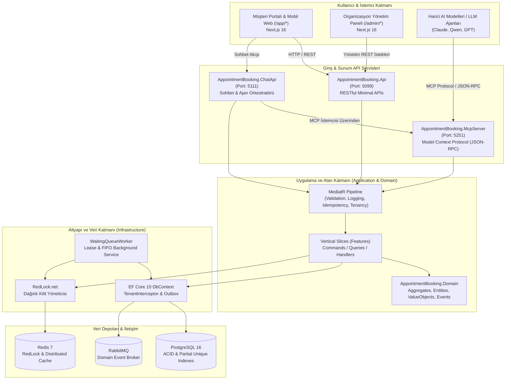
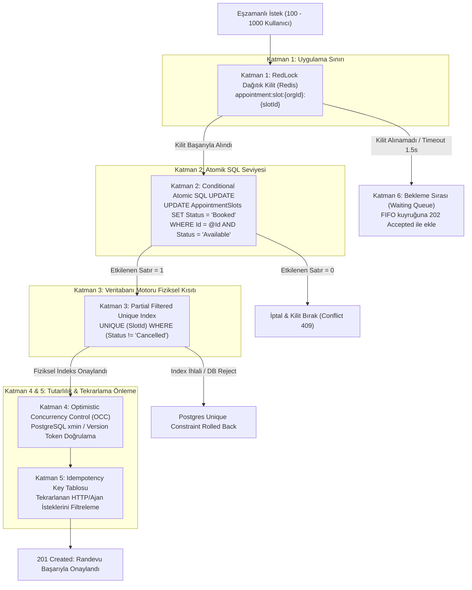
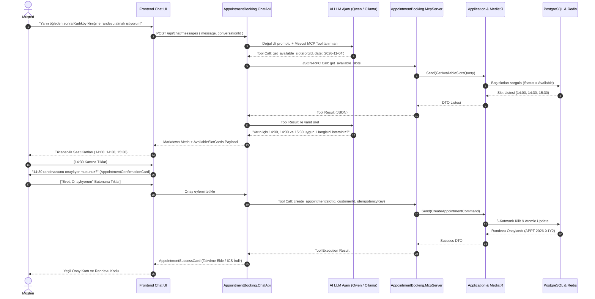
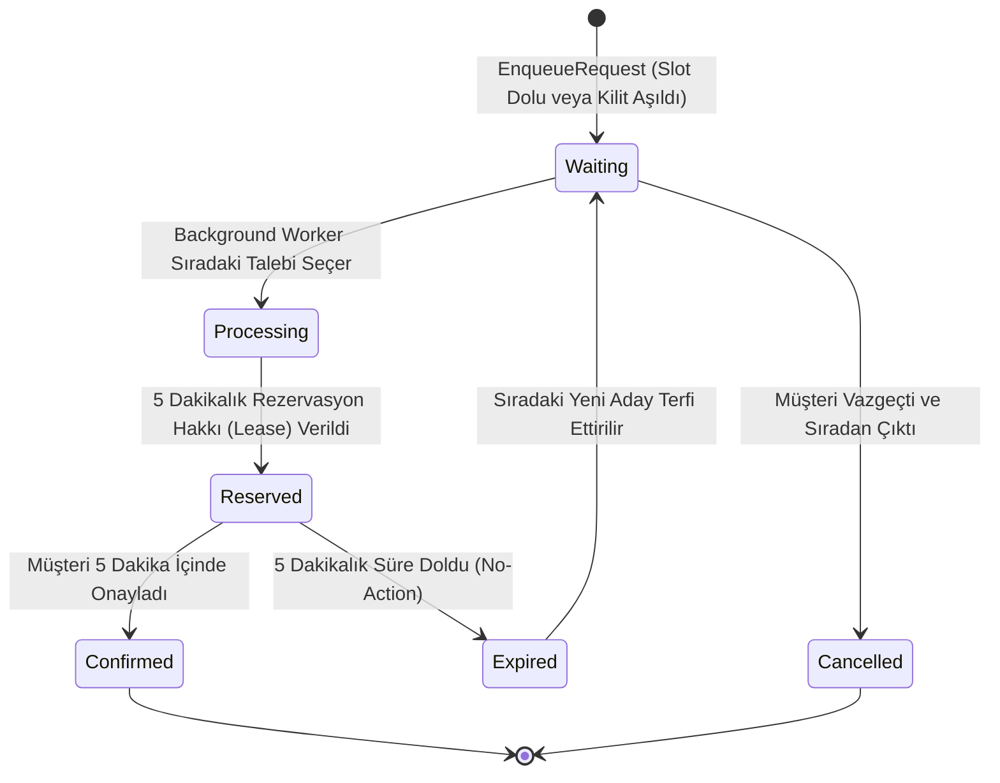
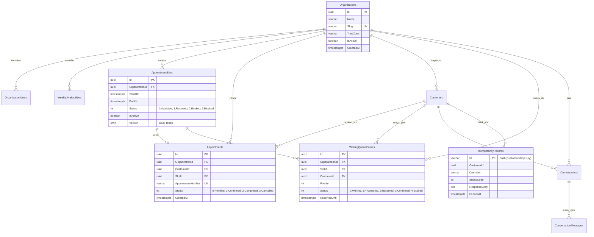

# 🏥 AI-Powered Multi-Tenant Appointment Booking Platform

> **Yüksek Eşzamanlılık (High-Concurrency)**, **Sıfır Çift Randevu Garantisi (Zero Double-Booking)** ve **Model Context Protocol (MCP)** tabanlı Yapay Zeka Ajan Entegrasyonuna sahip yeni nesil kurumsal randevu ve rezervasyon platformu.

---

## 📑 İçindekiler
1. [Proje Özeti ve Temel Özellikler](#-proje-özeti-ve-temel-özellikler)
2. [Teknoloji Yığını](#-teknoloji-yığını)
3. [Sistem Mimarisi (System Architecture)](#-sistem-mimarisi-system-architecture)
4. [Proje ve Dizin Yapısı (Codebase Structure)](#-proje-ve-dizin-yapısı-codebase-structure)
5. [Tasarım Kalıpları ve Mimari Prensipler](#-tasarım-kalıpları-ve-mimari-prensipler)
6. [6-Katmanlı Concurrency Savunma Modeli (Zero Double-Booking)](#-6-katmanlı-concurrency-savunma-modeli-zero-double-booking)
7. [Model Context Protocol (MCP) & Yapay Zeka Entegrasyonu](#-model-context-protocol-mcp--yapay-zeka-entegrasyonu)
8. [Akış ve Sıralama Diyagramları (Mermaid Diagrams)](#-akış-ve-sıralama-diyagramları-mermaid-diagrams)
9. [Veritabanı Şeması ve ER Diyagramı](#-veritabanı-şeması-ve-er-diyagramı)
10. [Frontend Mimarisi ve UI/UX Tasarımı](#-frontend-mimarisi-ve-uiux-tasarımı)
11. [Bekleme Sırası (Waiting Queue) ve Asenkron İşleyiş](#-bekleme-sırası-waiting-queue-ve-asenkron-işleyiş)
12. [Servis ve Port Haritası](#-servis-ve-port-haritası)
13. [Test Stratejisi ve Doğrulama Sonuçları](#-test-stratejisi-ve-doğrulama-sonuçları)
14. [Kurulum ve Yerel Çalıştırma Kılavuzu](#-kurulum-ve-yerel-çalıştırma-kılavuzu)

---

## 🎯 Proje Özeti ve Temel Özellikler

Bu platform; sağlık klinikleri, danışmanlık merkezleri, güzellik ve bakım salonları gibi randevu bazlı hizmet veren organizasyonlar için geliştirilmiş, multi-tenant (çok kiracılı), modern bir tam kapsamlı yazılım ekosistemidir.

### 🌟 Öne Çıkan Yetenekler:
* **🤖 Yapay Zeka Destekli Doğal Dil ile Randevu (Conversational AI):** Müşteriler karmaşık formlar ve takvimler yerine, doğal dille sohbet ederek uygun saatleri sorgular, tek tıkla kartlar üzerinden seçim yapar ve randevularını oluşturur/iptal eder.
* **🛡️ Sıfır Çift Randevu Garantisi (Zero Double-Booking):** Aynı randevu dilimine aynı anda gelen 500-1000 eşzamanlı istekte dahi tek bir randevunun çift yazılmasını matematiksel ve fiziksel olarak imkansız kılan **6-Kademeli Savunma Mimarisi (Defense-in-Depth)**.
* **🔌 Model Context Protocol (MCP) Desteği:** Anthropic / OpenAI standartlarında çalışan bağımsız bir `McpServer` sunucusu ile AI modellerinin veritabanına doğrudan dokunmadan, iş kuralları ve validasyon tünellerinden geçerek araç (tool) çalıştırması.
* **🏢 Çok Kiracılı İzolasyon (Logical Multi-Tenancy):** EF Core Global Query Filter, TenantInterceptor ve kompozit DB indeksleriyle organizasyonlar arası veri sızıntısının %100 engellenmesi.
* **⏳ Akıllı Bekleme Sırası (FIFO Waiting Queue):** Dolu veya çekişmeli slotlarda müşterilerin mağdur edilmeyip otomatik sıraya alınması; randevu iptali veya kiralama süresi (lease) aşımında sıradaki müşteriye otomatik tahsis.
* **⚡ Modern Next.js 16 Web Uygulaması:** Admin operasyonları ve mobil öncelikli müşteri sohbet arayüzünü tek bir tasarım sistemi altında buluşturan App Router tabanlı modern frontend.

---

## 🛠️ Teknoloji Yığını

| Katman | Teknolojiler |
| :--- | :--- |
| **Backend Core** | .NET 10 (C# 14), ASP.NET Core Minimal APIs |
| **Mimari Stiller** | Clean Architecture + Vertical Slice Architecture, CQRS, DDD |
| **İş Mantığı & MediatR** | MediatR, FluentValidation, Pipeline Behaviors |
| **Veri & ORM** | Entity Framework Core 10, Npgsql (PostgreSQL 16) |
| **Dağıtık Kilit & Cache** | Redis 7, RedLock.net (Dağıtık Kilit Yöneticisi), StackExchange.Redis |
| **Mesajlaşma & Olaylar** | RabbitMQ 3.13, Transactional Outbox / Inbox Pattern |
| **Yapay Zeka & MCP** | Model Context Protocol (JSON-RPC 2.0 / SSE), Qwen / Ollama / OpenAI Entegrasyonu |
| **Frontend** | Next.js 16 (App Router), React 19, TypeScript (Strict), Tailwind CSS v4 |
| **UI Bileşenleri & State** | Radix UI, TanStack React Query v5, Lucide React, Recharts, Sonner |
| **Gözlemlenebilirlik** | OpenTelemetry, Serilog, Structured JSON Logging |
| **Test Altyapısı** | xUnit, FluentAssertions, WebApplicationFactory, NetArchTest |
| **Konteynerizasyon** | Docker, Docker Compose, Multi-stage Dockerfiles |

---

## 🏗️ Sistem Mimarisi (System Architecture)

Sistem; bağımsız ölçeklenebilen API servisleri, merkezi uygulama çekirdeği (Application Core) ve zengin dış servis entegrasyonlarından oluşan modüler bir mimari üzerinde inşa edilmiştir:



---

## 📂 Proje ve Dizin Yapısı (Codebase Structure)

```text
appointment-ai-assistant/
├── AppointmentBooking.sln               # .NET Çözüm Dosyası
├── docker-compose.yml                   # PostgreSQL, Redis, RabbitMQ ve Servis Konteynerleri
├── Directory.Build.props                # Global C# kuralları, Nullable ve Warning konfigürasyonu
│
├── src/
│   ├── AppointmentBooking.Domain/       # Saf İş Kuralları (Framework bağımsız)
│   │   ├── Common/                      # BaseEntity, AggregateRoot, ValueObject, IDomainEvent
│   │   ├── Entities/                    # Organization, Customer, AppointmentSlot, Appointment, WaitingQueueEntry
│   │   ├── ValueObjects/                # TimeRange, TimeZoneCode, PhoneNumber, Money
│   │   ├── Enums/                       # SlotStatus, AppointmentStatus, QueueStatus
│   │   ├── Exceptions/                  # Domain-specific typed exception sınıfları
│   │   └── Events/                      # AppointmentCreatedDomainEvent, SlotReleasedDomainEvent vb.
│   │
│   ├── AppointmentBooking.Application/  # Dikey Özellik Dilimleri (Vertical Slice CQRS)
│   │   ├── Common/                      # ICommand, IQuery, Behaviours (Validation, Performance, Logging)
│   │   ├── Interfaces/                  # IDistributedLockManager, IApplicationDbContext, ITenantContext
│   │   └── Features/                    # Her iş yeteneği bağımsız klasörde kapsüllenir:
│   │       ├── Organizations/           # CreateOrg, GetOrg, GetBySlug, ListOrgs
│   │       ├── Availabilities/          # SetWeeklySchedule, GenerateSlots, ToggleSlotStatus
│   │       ├── Appointments/            # CreateAppointment, CancelAppointment, GetCustomerAppointments
│   │       ├── Customers/               # RegisterCustomer, GetCustomerDetails
│   │       └── WaitingQueue/            # EnqueueRequest, GetQueueStatus, CancelQueueRequest
│   │
│   ├── AppointmentBooking.Infrastructure/ # Dış Dünya Adaptörleri ve Kalıcılık
│   │   ├── Persistence/                 # ApplicationDbContext, Model Konfigürasyonları, Migrations
│   │   ├── Interceptors/                # TenantInterceptor (Multi-tenant global filtreleme)
│   │   ├── DistributedLock/             # RedLock.net entegrasyonu ve Fail-Closed stratejisi
│   │   ├── BackgroundServices/          # WaitingQueueWorker (Zaman aşımı ve sıra terfi işçisi)
│   │   └── Outbox/                      # OutboxMessageProcessor ve Event Dispatcher
│   │
│   ├── AppointmentBooking.Api/          # RESTful Minimal APIs (Admin & Public İstemciler)
│   │   ├── Endpoints/                   # IEndpoint arayüzü ile modüler endpoint tanımları
│   │   ├── Middlewares/                 # TenantResolutionMiddleware, GlobalExceptionHandlingMiddleware
│   │   └── Extensions/                  # ServiceCollection ve Swagger yapılandırmaları
│   │
│   ├── AppointmentBooking.McpServer/    # Model Context Protocol (MCP) Host Servisi
│   │   ├── Tools/                       # 9 adet resmi MCP Tool tanımı ve JSON Schema eşleyicileri
│   │   ├── Handlers/                    # JSON-RPC 2.0 isteklerini MediatR komutlarına çeviren katman
│   │   └── Transports/                  # HTTP POST (`/mcp`) ve SSE (`/mcp/sse`) protokol taşıyıcıları
│   │
│   └── AppointmentBooking.ChatApi/      # Müşteri Sohbet ve Yapay Zeka Orkestrasyonu
│       ├── Services/                    # LLM İstemcisi, Agent Session State Machine, Tool Caller
│       ├── Endpoints/                   # `/api/chat/messages`, `/api/chat/conversations`
│       └── Models/                      # AgentResponseDto, Discriminated Card Payload yapıları
│
├── frontend/                            # Next.js 16 + React 19 + Tailwind v4 Web İstemcisi
│   ├── src/
│   │   ├── app/
│   │   │   ├── (public)/                # Ana Sayfa, Organizasyon Keşif ve Tanıtım Sayfaları
│   │   │   ├── (auth)/                  # Giriş ve Kayıt Ekranları (Customer & Admin)
│   │   │   ├── (admin)/admin/           # Dashboard, Randevular, Takvim, Slot Üretici, Bekleme Sırası
│   │   │   └── (customer)/app/          # Müşteri Portalı: Doğal Dil AI Chat, Randevularım, Profil
│   │   ├── components/
│   │   │   ├── ui/                      # Tasarım sistemi temel bileşenleri (Button, Card, Input, Dialog...)
│   │   │   └── chat/                    # Özel sohbet kartları (AvailableSlots, Confirmation, Success...)
│   │   ├── lib/api/client.ts            # Tip güvenli modüler backend API istemcisi
│   │   └── providers/                   # React Query, Dark/Light Theme, Toast Providers
│   ├── Dockerfile                       # Multi-stage production container build
│   └── package.json
│
├── tests/
│   ├── AppointmentBooking.UnitTests/         # DDD kuralları, Slot overlap ve ValueObject birim testleri
│   ├── AppointmentBooking.ArchitectureTests/ # Clean Architecture katman kuralları (NetArchTest)
│   ├── AppointmentBooking.IntegrationTests/  # Gerçek DB ve Redis ile End-to-End API testleri
│   └── AppointmentBooking.ConcurrencyTests/  # 500 Eşzamanlı istek altında Zero Double-Booking yük testleri
│
└── docs/                                # Kapsamlı mimari ve teknik karar belgeleri (ADR)
```

---

## 💎 Tasarım Kalıpları ve Mimari Prensipler

### 1. Clean Architecture + Vertical Slice Architecture
Geleneksel katmanlı mimarilerde yaşanan "özelliklerin katmanlar arasına dağılması ve spagetti bağımlılıklar" problemi, **Vertical Slice (Dikey Dilim)** yaklaşımı ile çözülmüştür:
* Her bir iş özelliği (`CreateAppointment`, `GenerateSlots`, vb.) kendi klasöründe kendi `Command`, `Handler`, `Validator`, `Response` ve `Endpoint` bileşenlerini barındırır.
* Katmanlar arası bağımlılık kuralı: `Domain` sıfır dış kütüphaneye bağımlıdır. `Application` yalnızca `Domain`'e bağımlıdır. Dış adaptörler (`Infrastructure`, `Api`, `McpServer`) `Application` soyutlamalarını implemente eder.

### 2. Domain-Driven Design (DDD)
* **Aggregate Root:** `AppointmentSlot` ve `Appointment` birer Aggregate Root olup kendi iç tutarlılık kurallarını (invariants) korur.
* **Value Objects:** `TimeRange`, `PhoneNumber`, `Money` nesneleri değişmez (immutable) olarak modellenmiştir; geçersiz saat aralıkları nesne oluşturulurken engellenir.
* **Domain Events:** Randevu oluşturulduğunda veya iptal edildiğinde alan olayları fırlatılarak Transactional Outbox üzerinden asenkron abonelere aktarılır.

### 3. Pipeline Behaviors (Cross-Cutting Concerns)
MediatR üzerinden akan her istek otomatik olarak şu ardışık boru hattından geçer:
1. `TenantResolutionBehavior`: İstek sahibinin organizasyon yetkisini doğrular.
2. `ValidationBehavior`: FluentValidation ile giriş verilerini doğrular; hata varsa Handler'a girmeden `400 Bad Request` döner.
3. `IdempotencyBehavior`: İstek başlığındaki `IdempotencyKey` veritabanında daha önce işlenmişse, sonucu doğrudan cache/DB'den döndürür.
4. `LoggingAndPerformanceBehavior`: 500ms'yi aşan işlemleri otomatik uyarır ve OpenTelemetry izi (trace) oluşturur.

### 4. Transactional Outbox Pattern
Veritabanı transaction'ı commit edilirken alan olayları aynı ACID sınırları içinde `OutboxMessages` tablosuna yazılır. Ayrı bir arka plan işçisi bu mesajları RabbitMQ'ya iletir. Böylece veritabanı yazımı ile mesaj kuyruğu arasındaki "Dual-Write" tutarsızlığı önlenir.

---

## 🛡️ 6-Katmanlı Concurrency Savunma Modeli (Zero Double-Booking)

Sistemin en kritik sözü: **"Aynı randevu slotuna 1.000 kişi aynı milisaniyede tıklasa dahi, asla çift randevu oluşamaz."**

Bu garanti tek bir bileşene (yalnızca Redis'e veya yalnızca veritabanına) emanet edilmemiş, **6 Kademeli Derinlemesine Savunma (Defense-in-Depth)** kurulmuştur:



### Savunma Katmanlarının Ayrıntıları:
1. **Katman 1 (RedLock.net):** Dağıtık ortamda koşan birden çok API node'u arasında kilitleme yapar. Veritabanını thread ve bağlantı tükenmesinden korur.
2. **Katman 2 (Conditional SQL UPDATE):** Redis split-brain yaşasa veya kilit süresi dolsa dahi, `UPDATE ... WHERE Status = 'Available'` sorgusu yalnızca ilk gelen bağlantıda 1 satır etkiler; diğerleri 0 alır ve rollback olur.
3. **Katman 3 (Database Partial Unique Index):** En uç yazılım hatalarında bile PostgreSQL veritabanı motoru `IX_Appointments_SlotId_Active` indeksi sayesinde fiziksel olarak aynı slota 2 aktif randevu kaydını diske yazmayı reddeder.
4. **Katman 4 (Optimistic Concurrency / xmin):** Yönetici aynı anda o slotu iptal ediyor veya mesaisini güncelliyorsa çakışmayı tespit eder.
5. **Katman 5 (Idempotency Key):** Ağ kesintisi sonucu kullanıcının veya AI modelinin aynı isteği ardı ardına 3 kez göndermesi durumunda mükerrer kayıt açılmasını engeller, mevcut randevuyu döner.
6. **Katman 6 (Waiting Queue FIFO):** Kilidi alamayan kullanıcılar hata ekranıyla karşılaşmaz; doğrudan sıralı bekleme kuyruğuna transfer edilir.

---

## 🤖 Model Context Protocol (MCP) & Yapay Zeka Entegrasyonu

Platform, modern LLM ajanlarının güvenli entegrasyonu için açık standart olan **Model Context Protocol (MCP)** sunucusunu barındırır.

### MCP Araçları Kataloğu (9 Resmi Tool):
1. `get_organization_info`: Organizasyonun çalışma saatlerini, adresini, iletişim bilgilerini ve saat dilimini döner.
2. `get_available_dates`: Belirli bir tarih aralığında randevuya açık günleri listeler.
3. `get_available_slots`: İlgili güne ait müsait saat aralıklarını (slotları) yerel saatle döner.
4. `create_appointment`: Dağıtık kilit ve çift rezervasyon koruması altında randevu kaydı oluşturur.
5. `get_appointment`: Randevu ID ile durum ve detay sorgular.
6. `get_customer_appointments`: Müşterinin aktif ve geçmiş tüm randevularını listeler.
7. `cancel_appointment`: Randevuyu iptal eder, slotu serbest bırakır ve sıradaki kullanıcıya devreder.
8. `get_queue_status`: Bekleme sırasındaki konumu, tahmini süreyi ve kiralama (lease) geri sayımını döner.
9. `cancel_queue_request`: Müşteriyi bekleme sırasından çıkarır.

> **Güvenlik Kuralı:** AI Ajanı asla doğrudan veritabanı sorgusu (`SELECT/UPDATE`) yapamaz. Yalnızca bu MCP araçları üzerinden istek atar; istekler arka planda MediatR boru hattından, tenant validasyonundan ve concurrency kilitlerinden geçer.

---

## 📊 Akış ve Sıralama Diyagramları (Mermaid Diagrams)

### 1. Yapay Zeka ile Doğal Dil Üzerinden Randevu Akışı



---

### 2. Bekleme Sırası Durum Makinesi (Waiting Queue State Machine)



---

## 🗄️ Veritabanı Şeması ve ER Diyagramı



---

## 💻 Frontend Mimarisi ve UI/UX Tasarımı

Frontend projesi, **Next.js 16 (App Router)** mimarisiyle sıfırdan geliştirilmiş, son derece zengin ve modern bir kullanıcı deneyimi sunar:

### 1. Bölümlenmiş Deneyim Alanları:
* **Admin Çalışma Alanı (`/admin/*`):**
  * `dashboard`: Günlük KPI metrikleri, randevu doluluk oranları, Recharts etkileşimli aktivite grafiği.
  * `calendar`: Günlük/Haftalık dinamik slot ızgarası, tek tıkla slot kilitleme/açma toggle'ı.
  * `availability`: Haftalık çalışma saatleri şablonu ve toplu slot üretici motoru (Batch Generator).
  * `appointments`: Filtrelenebilir, aranabilir kurumsal randevu tablosu ve iptal modalları.
  * `waiting-queue`: Canlı bekleme sıraları, öncelik skorları ve kalan süre sayaçları.
* **Müşteri Portalı (`/app/*`):**
  * `chat` ve `chat/[slug]`: Tam ekran, mobil öncelikli, zengin kart destekli AI randevu asistanı.
  * `my-appointments`: Aktif, geçmiş ve iptal edilen randevular, takvime kaydetme (ICS export).
  * `organizations`: Hizmet veren kurumları keşfetme ve profillerini inceleme rehberi.

### 2. Akıllı Sohbet Kartları (Discriminated Action Cards):
Sohbet arayüzü asla ham JSON veya düzensiz metin göstermez; backend'in döndürdüğü `cardType` etiketine göre özel arayüz kartları render eder:
* `AvailableSlotCards`: Seçilebilir interaktif saat butonları.
* `AppointmentConfirmationCard`: Açık onay gerektiren "Evet, Onaylıyorum" / "Değiştir" aksiyon kartı.
* `AppointmentSuccessCard`: Onay rozeti, ICS takvim indirme ve randevu özet bilgisi.
* `AppointmentCancellationCard`: İptal gerekçesi ve iptal teyit kartı.
* `WaitingQueueCard`: Canlı sıra numarası ve 5 dakikalık rezervasyon geri sayım sayacı.
* `TypingIndicator`: AI modelinin hangi aracı çalıştırdığını bildiren mikro durum animasyonu.

---

## 🌐 Servis ve Port Haritası

Yerel geliştirme veya konteyner ortamında çalışan servislerin varsayılan ağ haritası:

| Servis Adı | Port | Protokol / Rol | Açıklama |
| :--- | :--- | :--- | :--- |
| **Next.js Frontend** | `http://localhost:3000` | HTTP / Web UI | Admin Dashboard ve Müşteri Sohbet Portalı |
| **Appointment Core API** | `http://localhost:5099` | HTTP / REST | Organizasyon, Müsaitlik, Slot ve Randevu Minimal API'leri |
| **AI Chat API** | `http://localhost:5111` | HTTP / REST | LLM ve Sohbet Oturum Orkestratörü |
| **MCP Server** | `http://localhost:5251` | JSON-RPC / SSE | Model Context Protocol Tool Sunucusu |
| **PostgreSQL 16** | `localhost:5432` | TCP / SQL | İlişkisel Veritabanı (`appointment_db`) |
| **Redis 7** | `localhost:6379` | TCP / Cache | RedLock Dağıtık Kilit & Dağıtık Önbellek |
| **RabbitMQ Management** | `http://localhost:15672` | HTTP / AMQP | Mesaj Kuyruğu Yönetim Paneli (Kullanıcı: `appointment_guest`) |

---

## 🧪 Test Stratejisi ve Doğrulama Sonuçları

Sistemde mimari kuralları, iş mantığını ve eşzamanlılık dayanıklılığını güvenceye alan **41 adet otomatik test** bulunmaktadır:

```text
Test Run Summary: Total: 41 | Passed: 41 | Failed: 0 | Skipped: 0
```

1. **`AppointmentBooking.UnitTests` (17 Test - Geçti):**
   * Aggregate root invariant kontrolleri, çakışan slot saatlerinin tespiti, Value Object kuralları ve durum makinesi geçişleri.
2. **`AppointmentBooking.ArchitectureTests` (5 Test - Geçti):**
   * NetArchTest ile Clean Architecture katman bağımlılık kurallarının korunması (örneğin `Domain` katmanının hiçbir üst katmana referans vermemesi).
3. **`AppointmentBooking.IntegrationTests` (13 Test - Geçti):**
   * Gerçek PostgreSQL ve Redis konteynerleri üzerinde tam uçtan uca randevu yaşam döngüsü, tenant izolasyonu ve MCP Server tool çağrıları.
4. **`AppointmentBooking.ConcurrencyTests` (6 Test - Geçti):**
   * **500 Eşzamanlı İstek Testi:** Aynı 30 dakikalık randevu slotuna aynı anda 500 paralel istek atıldığında tam olarak **1 adet 201 Created**, kalan **499 adet 202 Queued / 409 Conflict** üretildiği ve veritabanında kesinlikle tek bir aktif kayıt oluştuğu kanıtlanmıştır.

---

## 🚀 Kurulum ve Yerel Çalıştırma Kılavuzu

### 1. Ön Gereksinimler
* [.NET 10 SDK](https://dotnet.microsoft.com/download)
* [Node.js 20+ & npm](https://nodejs.org/)
* [Docker & Docker Compose](https://www.docker.com/)

### 2. Altyapı Servislerini Başlatma
Veritabanı, Redis ve RabbitMQ servislerini arka planda ayağa kaldırın:
```bash
docker-compose up -d postgres redis rabbitmq
```

### 3. Backend Servislerini Çalıştırma
Ayrı terminal pencerelerinde servisleri başlatın:

**1. Core API (Port: 5099):**
```bash
dotnet run --project src/AppointmentBooking.Api/AppointmentBooking.Api.csproj
```

**2. MCP Server (Port: 5251):**
```bash
dotnet run --project src/AppointmentBooking.McpServer/AppointmentBooking.McpServer.csproj
```

**3. Chat API (Port: 5111):**
```bash
dotnet run --project src/AppointmentBooking.ChatApi/AppointmentBooking.ChatApi.csproj
```

### 4. Frontend Uygulamasını Başlatma
```bash
cd frontend
npm install
npm run dev -- -p 3000
```

Uygulamanız artık hazır!
* **Müşteri & Admin Portalı:** [http://localhost:3000](http://localhost:3000)
* **Core API Swagger:** [http://localhost:5099/swagger](http://localhost:5099/swagger)
* **MCP Server Health:** [http://localhost:5251/health](http://localhost:5251/health)

---

## 📄 Lisans
Bu proje kurumsal kullanım ve yapay zeka destekli randevu orkestrasyonu amacıyla özel olarak geliştirilmiştir. Tüm hakları saklıdır.
