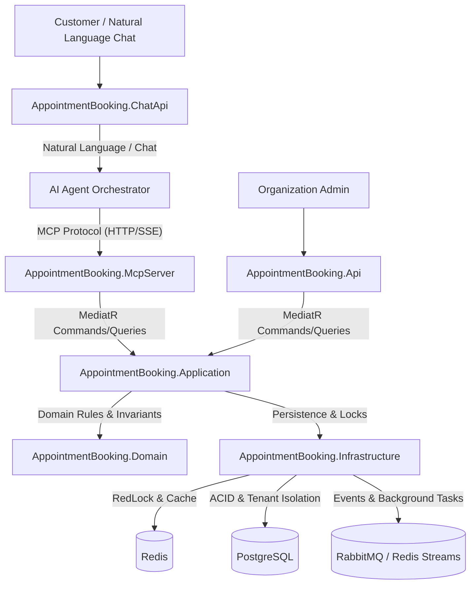

# Appointment Booking Platform - Architecture

## 1. System Overview
The AI-Powered Appointment Booking Platform is a distributed, multi-tenant system designed for high concurrency, zero double-booking, and seamless AI agent interaction via Model Context Protocol (MCP).

## 2. Component Diagram

## 3. Solution Structure
- `src/AppointmentBooking.Domain`: Aggregate roots, Entities, ValueObjects, Events, Domain Exceptions.
- `src/AppointmentBooking.Application`: Vertical slices (Features), MediatR handlers, Pipeline behaviors (Validation, Logging, Idempotency, Performance).
- `src/AppointmentBooking.Infrastructure`: EF Core DbContext, Tenant interceptors, Migrations, RedLock distributed lock manager, Outbox/Inbox worker, Serilog & OpenTelemetry observability.
- `src/AppointmentBooking.Api`: RESTful API endpoints for organization admins and public web clients.
- `src/AppointmentBooking.McpServer`: Standard Model Context Protocol server exposing tool capabilities to AI agents.
- `src/AppointmentBooking.ChatApi`: Conversational API hosting the AI Agent, confirmation state machine, and customer interactions.
- `tests/AppointmentBooking.UnitTests`: Domain and application unit tests.
- `tests/AppointmentBooking.IntegrationTests`: End-to-end integration tests using real DB & Redis.
- `tests/AppointmentBooking.ArchitectureTests`: Architectural integrity tests (dependency rules, clean architecture enforcement).
- `tests/AppointmentBooking.ConcurrencyTests`: High-load stress tests (10, 50, 100, 500, 1000 concurrent requests).
