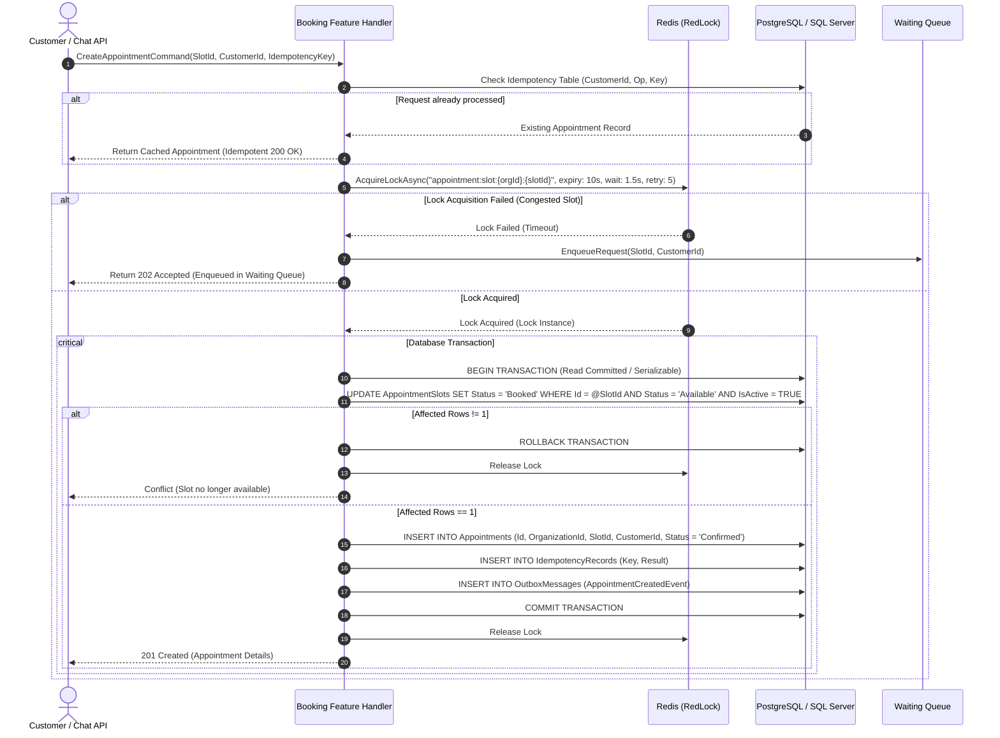

# Concurrency Strategy & Distributed Lock Architecture

## 1. Overview
The most critical requirement of the Appointment Booking Platform is the guarantee of **Zero Double-Booking** under extreme concurrency (100 to 1,000 simultaneous requests per slot).

To achieve absolute data consistency, we reject the naive assumption that a single mechanism (like Redis alone or DB transactions alone) is sufficient. We implement a **6-Layer Defense-in-Depth Concurrency Model**.

---

## 2. Six-Layer Defense-in-Depth Model

| Layer | Technology | Primary Function | Failure Mode Handled |
| :--- | :--- | :--- | :--- |
| **Layer 1** | **RedLock.net (Redis Distributed Lock)** | Serialization of incoming requests at the application edge | Protects database from connection exhaustion and thread contention during flash traffic |
| **Layer 2** | **Conditional SQL UPDATE** | Atomic state change: `Status = Booked WHERE Id = @Id AND Status = Available` | Stale locks, Redis split-brain, expired lease before DB write |
| **Layer 3** | **Database Partial Unique Index** | `UNIQUE ("SlotId") WHERE ("Status" != 'Cancelled')` | Extreme edge cases, software bugs, manual DBA queries |
| **Layer 4** | **Optimistic Concurrency Control** | Entity `xmin` / `RowVersion` token | Slot schedule edits while a booking is in-flight |
| **Layer 5** | **Idempotency Key Verification** | `(CustomerId, Operation, IdempotencyKey)` table | Client network disconnects and HTTP retries |
| **Layer 6** | **Waiting Queue with Lease Expiry** | Redis Streams / DB-backed FIFO Queue | Graceful backpressure for requests that miss the lock |

---

## 3. High-Concurrency Booking Sequence

---

## 4. Failure Mode Analysis & Edge Case Safeguards

### 4.1 Redis Connection Loss or Crash
- **Behavior**: If Redis is unreachable, the system implements **Fail-Closed**. No un-locked booking can proceed through the fast path. Requests either wait for reconnection or get safely queued/rejected with retry advice.

### 4.2 Application Crash After Lock Acquisition
- **Behavior**: RedLock keys have an explicit TTL lease (default: 10 seconds). If the instance crashes, the lock automatically expires in Redis. Because the DB transaction was never committed, the slot remains `Available`.

### 4.3 Database Transaction Hangs Exceeding Lock TTL (Stale Lock)
- **Behavior**: Suppose instance A acquires a lock with 10s TTL, but GC pause or network latency causes it to resume after 11s. Instance B acquires the lock. Instance A attempts DB commit.
  - **Resolution**: Layer 2 (conditional UPDATE) and Layer 3 (partial unique index) kick in. Whichever instance executes the atomic UPDATE first will succeed. The second instance receives 0 rows affected or a unique index constraint violation, rolling back safely!

### 4.4 Same Client Sends Duplicate Concurrent Requests
- **Behavior**: Both requests carry the identical `IdempotencyKey`. The first one acquires the lock and writes the idempotency record. The second one either gets blocked by the lock or fails on the DB unique constraint on idempotency key.

### 4.5 Cancellation Concurrency
- **Behavior**: Cancelling an appointment also acquires the slot's distributed lock, transitions the appointment to `Cancelled`, and sets the slot back to `Available` (or notifies the Waiting Queue) inside an atomic transaction.
