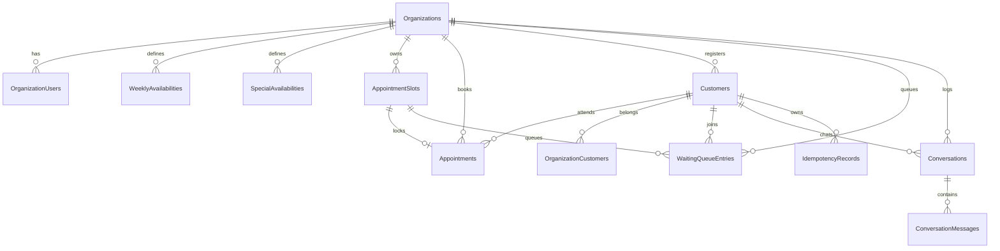

# Database Design & Persistence Architecture

## 1. Overview
The platform utilizes **PostgreSQL 16** managed via **Entity Framework Core 10** (`Npgsql.EntityFrameworkCore.PostgreSQL`).
All timestamps are stored strictly in UTC (`timestamp with time zone` / `DateTimeOffset` with `TimeSpan.Zero`).

---

## 2. Relational Schema & Entity Relationship



---

## 3. Physical Tables & Schema Definitions

### 3.1. `Organizations`
- `Id` (UUID, PK)
- `Name` (VARCHAR 200, NOT NULL)
- `Slug` (VARCHAR 100, UNIQUE, NOT NULL) - URL identifier
- `Email` (VARCHAR 255, NOT NULL)
- `PhoneNumber` (VARCHAR 30, NOT NULL)
- `Address` (VARCHAR 500, NOT NULL)
- `TimeZone` (VARCHAR 50, NOT NULL) - IANA identifier (e.g. `Europe/Istanbul`)
- `IsActive` (BOOLEAN, DEFAULT TRUE)
- `CreatedAt`, `UpdatedAt` (TIMESTAMPTZ)

### 3.2. `AppointmentSlots`
- `Id` (UUID, PK)
- `OrganizationId` (UUID, FK, NOT NULL) - Tenant discriminator
- `StartUtc` (TIMESTAMPTZ, NOT NULL)
- `EndUtc` (TIMESTAMPTZ, NOT NULL)
- `Status` (INT, NOT NULL) - `0: Available, 1: Reserved, 2: Booked, 3: Blocked`
- `IsActive` (BOOLEAN, NOT NULL)
- `Version` (xmin system column) - PostgreSQL optimistic concurrency token
- `CreatedAt`, `UpdatedAt` (TIMESTAMPTZ)
- **Index**: `IX_AppointmentSlots_Org_Status_Active` on `("OrganizationId", "Status", "IsActive")`

### 3.3. `Appointments`
- `Id` (UUID, PK)
- `OrganizationId` (UUID, FK, NOT NULL)
- `CustomerId` (UUID, FK, NOT NULL)
- `SlotId` (UUID, FK, NOT NULL)
- `AppointmentNumber` (VARCHAR 50, UNIQUE, NOT NULL) - e.g. `APPT-2026-9A8B7C`
- `Status` (INT, NOT NULL) - `0: Pending, 1: Confirmed, 2: Completed, 3: Cancelled, 4: NoShow`
- `Description` (VARCHAR 1000)
- `CancellationReason` (VARCHAR 500)
- `CancelledAt` (TIMESTAMPTZ)
- `CreatedAt`, `UpdatedAt` (TIMESTAMPTZ)
- **Layer 3 Filtered Partial Unique Index**:
  ```sql
  CREATE UNIQUE INDEX "IX_Appointments_SlotId_Active"
  ON "Appointments" ("SlotId")
  WHERE "Status" <> 3;
  ```
  *Physical guarantee against double-booking even if Redis distributed locks fail.*

### 3.4. `WaitingQueueEntries`
- `Id` (UUID, PK)
- `OrganizationId` (UUID, FK, NOT NULL)
- `SlotId` (UUID, FK, NOT NULL)
- `CustomerId` (UUID, FK, NOT NULL)
- `RequestId` (VARCHAR 100, NOT NULL)
- `Priority` (INT, NOT NULL, DEFAULT 0)
- `Status` (INT, NOT NULL) - `0: Waiting, 1: Processing, 2: Reserved, 3: Confirmed, 4: Expired, 5: Failed, 6: Cancelled`
- `ReservedUntil` (TIMESTAMPTZ, NULL) - Lease deadline for customer confirmation
- `CreatedAt`, `UpdatedAt`, `ProcessedAt` (TIMESTAMPTZ)
- **Index**: `IX_WaitingQueue_Slot_Status_Priority` on `("SlotId", "Status", "Priority" DESC, "CreatedAt" ASC)`

### 3.5. `IdempotencyRecords`
- `Id` (VARCHAR 300, PK) - Composite key: `hash(CustomerId:Operation:IdempotencyKey)`
- `CustomerId` (UUID, NOT NULL)
- `Operation` (VARCHAR 100, NOT NULL)
- `IdempotencyKey` (VARCHAR 200, NOT NULL)
- `RequestHash` (VARCHAR 64, NOT NULL)
- `StatusCode` (INT, NOT NULL)
- `ResponseBody` (TEXT, NOT NULL)
- `ExpiresAt` (TIMESTAMPTZ, NOT NULL)
- `CreatedAt` (TIMESTAMPTZ, NOT NULL)

### 3.6. `OutboxMessages` & `InboxMessages`
- Reliable asynchronous domain event publishing via Transactional Outbox pattern.

---

## 4. Multi-Tenant Global Query Filters
Implemented in `ApplicationDbContext.OnModelCreating`:
```csharp
builder.Entity<T>().HasQueryFilter(e =>
    EF.Property<bool>(this, nameof(IsSuperAdmin)) ||
    e.OrganizationId == EF.Property<Guid>(this, nameof(CurrentOrganizationId)));
```
Guarantees tenant isolation by default. The `WaitingQueueWorker` and administration services invoke `tenantContext.SetTenant(Guid.Empty, isSuperAdmin: true)` to safely scan cross-tenant background queues.
