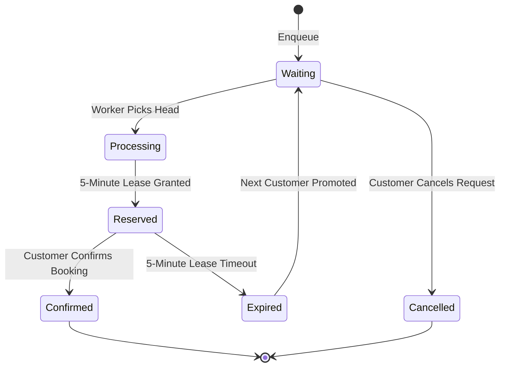

# Waiting Queue Architecture & Asynchronous Lease Processing

## 1. Overview
When flash-crowd demand saturates an appointment slot or when lock acquisition times out, incoming requests are not dropped with generic errors; instead, they enter **Layer 6: Waiting Queue FIFO Fallback**.

---

## 2. Queue State Machine

---

## 3. Asynchronous Background Worker (`WaitingQueueWorker`)
The background service runs periodically (default: 5 seconds) as an `IHostedService` with SuperAdmin tenant bypass.

### 3.1. Expired Reservation Scanning
1. Scans for entries where `Status == QueueStatus.Reserved` and `ReservedUntil <= DateTimeOffset.UtcNow`.
2. Acquires Redis RedLock for slot: `appointment:slot:{orgId}:{slotId}`.
3. Transitions entry to `QueueStatus.Expired`.
4. Checks if another customer is in `Waiting` status for this slot.
   - **If exists**: Advances top entry to `Processing` -> `Reserved` with a fresh 5-minute lease window and notifies the customer via Chat API.
   - **If empty**: Releases the slot back to `Available` via atomic conditional SQL update (`ExecuteConditionalSlotReleaseAsync`).

### 3.2. Orphaned Available Slot Allocation
1. Scans for slots in `Available` status that have pending `Waiting` entries.
2. Under distributed lock, allocates slot to the head of the queue (`Priority DESC, CreatedAt ASC`).

---

## 4. Fair Prioritization
- Queue entries support priority weighting (`Priority` column, default: 0).
- Standard sorting: `ORDER BY "Priority" DESC, "CreatedAt" ASC`.
